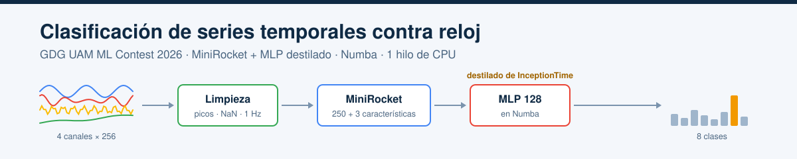
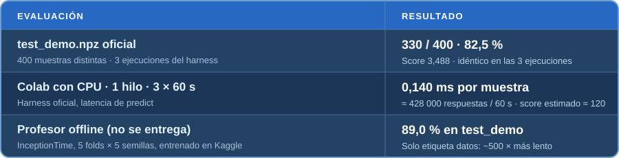
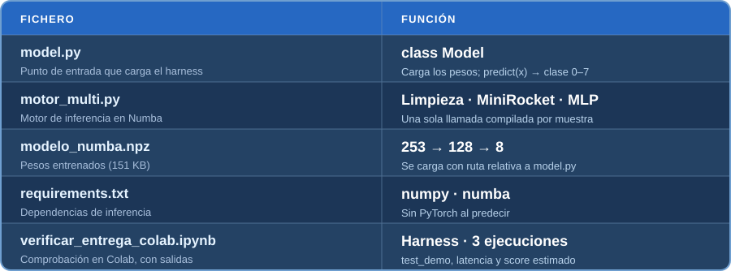

<div align="center">


<br>
  
  
  
  
  
  <a href="https://colab.research.google.com/github/diegoarangureen/gdg-ml-contest-entrega/blob/main/verificar_entrega_colab.ipynb"></a>
  <a href="LICENSE"></a>
  <br>
  <a href="https://github.com/xabat111"></a>
  <a href="https://github.com/diegoarangureen"></a>
  <p>
    <a href="README.md"></a>
  </p>
</div>

# GDG UAM ML Contest 2026

Nuestra entrega de equipo para el [GDG UAM ML Contest 2026](https://gdguam.es/l/ml-contest). La tarea es clasificar una serie temporal de cuatro canales y 256 pasos en una de ocho clases. El harness oficial llama a `predict` con una muestra cada vez, y el score combina la precisión por clase con el número de muestras contestadas en 60 s. Por eso el modelo tiene que ser **robusto al cambio train → test** y **muy rápido en un solo hilo de CPU**.

## Modelo

`model.py` carga `modelo_numba.npz` y ejecuta todo el proceso en **una sola llamada compilada con Numba por muestra**:

1. **Limpieza robusta:** picos y tramos congelados a NaN, interpolación lineal, normalización mediana/IQR por canal y remuestreo a una rejilla común de 1 Hz con `sample_rate`. Nunca usa `level`, `group` ni la escala absoluta.
2. **253 características:** 250 convoluciones de [MiniRocket](https://arxiv.org/abs/2012.08791) y 3 de asimetría temporal.
3. **MLP 253 → 128 → 8**, **destilado** de un ensemble de tres MLP de 256, que a su vez se destilaron de un profesor **InceptionTime** (5 folds × 5 semillas, entrenado con GPU en Kaggle), con 8 pasadas extra de datos corrompidos como los de test.

Al predecir no necesita PyTorch, datos de entrenamiento ni internet, y nunca se abstiene. La [nota de enfoque](APPROACH.es.md) explica cómo llegamos aquí y qué no funcionó.

## Resultados



En Colab se usó el harness oficial sobre el fichero de train, que se agota a las 100 000 muestras, así que el score de 60 s es **estimado** a partir de la latencia medida: `Score ≈ √(N/8)·gm_f` con `N = 60 s / 0,140 ms ≈ 428 000`. Con la calidad por clase medida en una validación corrompida de 57 000 filas (gm_f 0,520) sale **≈ 120**; con la demo de 400 muestras, más ruidosa (gm_f 0,493), **≈ 114**.

| Modelo | Acierto demo | Score demo | Latencia (Colab) | Score estimado (60 s) |
|---|---|---|---|---|
| Baseline oficial (features + gradient boosting) | 43,3 % | 0,21 | ~35 ms | ~2 |
| Nuestro primer alumno rápido (MiniRocket 250 + MLP 64) | 81,8 % | 3,42 | 0,166 ms | ~101 |
| **Esta entrega (MLP 128 destilado)** | **82,5 %** | **3,49** | **0,140 ms** | **≈ 120** |
| Profesor InceptionTime (no se entrega) | 89,0 % | 4,66 | ~15–30 ms (est.) | ~11–16 |

## Ficheros de la entrega



El harness oficial aporta `competition_api.py`; no forma parte de este repositorio.

## Prueba desde un clon limpio

### Windows · PowerShell

**1. Clona la entrega y los materiales oficiales**

```powershell
New-Item -ItemType Directory gdg-uam-submission-check
Set-Location gdg-uam-submission-check
git clone https://github.com/diegoarangureen/gdg-ml-contest-entrega.git submission-check
git clone https://github.com/GDG-UAM/ml-contest-materials.git
```

**2. Crea el entorno e instala las dependencias de inferencia**

```powershell
py -3 -m venv .venv
& .\.venv\Scripts\python.exe -m pip install -r .\submission-check\requirements.txt
```

**3. Descarga la demo pública y ejecuta el harness oficial**

```powershell
curl.exe -fL --create-dirs -o ml-contest-materials\data\test_demo.npz `
  https://github.com/GDG-UAM/ml-contest-materials/releases/latest/download/test_demo.npz
Set-Location ml-contest-materials
& ..\.venv\Scripts\python.exe harness.py evaluate --model ..\submission-check\model.py `
  --source file:data/test_demo.npz --runs 1
```

### macOS / Linux · Terminal

```bash
mkdir gdg-uam-submission-check && cd gdg-uam-submission-check
git clone https://github.com/diegoarangureen/gdg-ml-contest-entrega.git submission-check
git clone https://github.com/GDG-UAM/ml-contest-materials.git
python3 -m venv .venv
.venv/bin/python -m pip install -r submission-check/requirements.txt
curl -fL --create-dirs -o ml-contest-materials/data/test_demo.npz \
  https://github.com/GDG-UAM/ml-contest-materials/releases/latest/download/test_demo.npz
cd ml-contest-materials
../.venv/bin/python harness.py evaluate --model ../submission-check/model.py \
  --source file:data/test_demo.npz --runs 1
```

La demo pública debe dar **330 aciertos de 400** (82,5 %) y un score de **3,488**. El primer `Model()` compila Numba (unos 15–20 s, muy por debajo del límite de 120 s); la latencia depende del ordenador.

### Google Colab · sin instalar nada

El [notebook de verificación](https://colab.research.google.com/github/diegoarangureen/gdg-ml-contest-entrega/blob/main/verificar_entrega_colab.ipynb), guardado con sus salidas, ejecuta el harness oficial en Colab con CPU: 3 ejecuciones sobre `test_demo` y 3 ejecuciones de 60 s de `predict` para medir la latencia, más una checklist de las reglas del concurso. Si el repositorio es privado, pide un token de GitHub de solo lectura, que no se guarda.

1. Ábrelo y elige **Entorno de ejecución → Cambiar tipo → CPU**.
2. Pulsa **Entorno de ejecución → Ejecutar todo** (unos 10–15 min).
3. Revisa la tabla de resultados y la checklist ✅ del final.

## Posibles mejoras y líneas futuras

- **Corrección de priors sin etiquetas.** Calibrar un desplazamiento de los logits por clase (sobre todo en las clases 6 y 7) con datos tipo test sin etiquetas, para que el reparto de predicciones se acerque al equilibrado esperado. Los sesgos ajustados con la validación de train no aportaban nada, porque el cambio solo se ve en datos tipo test.
- **Superar el techo de MiniRocket.** El alumno se queda en gm_f ≈ 0,52 mientras que el profesor llega a 0,72. Una CNN 1D algo mayor (~50 k parámetros) servida con ONNX Runtime e I/O Binding, o un alumno híbrido MiniRocket + CNN pequeña, puede captar más del profesor con una latencia parecida.
- **Más características diseñadas a mano.** En nuestro análisis, la asimetría temporal separaba las clases 4 y 5, la cuadratura de fase entre los canales 0 y 1 marcaba la clase 1 y la modulación de amplitud, la clase 3; añadirlas al alumno cuesta poco en Numba.
- **Destilación más fuerte.** Usar como profesor el ensemble InceptionTime + ConvTran (90,0 % en la demo), entrenar los alumnos en GPU con muchas más pasadas corrompidas y elegir el checkpoint según el recall de la clase 6.
- **Inferencia más rápida.** La limpieza robusta es una parte importante de la latencia; una limpieza más ligera y pesos int8/fp16 darían bastantes más respuestas en 60 s.
- **Mejor simulador del test.** Modelar con más fidelidad el cambio de la clase 6 (el subgrupo aislado de train que no aparece en test), para que la validación se parezca todavía más a la demo.

## Autores

- **Xabat Arin Mendizabal** · [@xabat111](https://github.com/xabat111)
- **Diego Aranguren Gracia** · [@diegoarangureen](https://github.com/diegoarangureen)

## Licencia

Publicado bajo la [licencia MIT](LICENSE).
