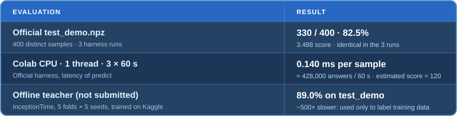
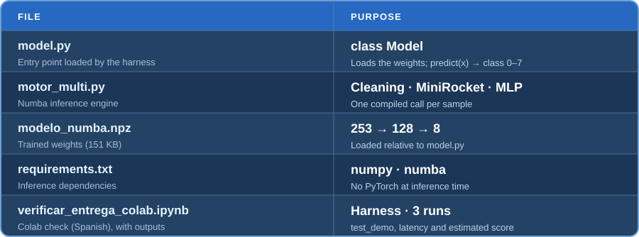

<div align="center">


<br>
  
  
  
  
  
  <a href="https://colab.research.google.com/github/diegoarangureen/gdg-ml-contest-entrega/blob/main/verificar_entrega_colab.ipynb"></a>
  <a href="LICENSE"></a>
  <br>
  <a href="https://github.com/xabat111"></a>
  <a href="https://github.com/diegoarangureen"></a>
  <p>
    <a href="README.es.md"></a>
  </p>
</div>

# GDG UAM ML Contest 2026

Our team entry for the [GDG UAM ML Contest 2026](https://gdguam.es/l/ml-contest). The task is to classify a four-channel, 256-step time series into one of eight classes. The official harness calls `predict` on one sample at a time and the score combines per-class precision with the number of samples answered in 60 s, so the model has to be **robust to the train → test shift** and **very fast on one CPU thread**.

## Model

`model.py` loads `modelo_numba.npz` and runs the whole pipeline in **a single Numba-compiled call per sample**:

1. **Robust cleaning:** spikes and frozen stretches to NaN, linear interpolation, per-channel median/IQR normalisation and resampling to a common 1 Hz grid using `sample_rate`. `level`, `group` and absolute scale are never used.
2. **253 features:** 250 [MiniRocket](https://arxiv.org/abs/2012.08791) convolutional features plus 3 temporal-asymmetry features.
3. **MLP 253 → 128 → 8**, **distilled** from an ensemble of three 256-unit MLPs that were themselves distilled from an **InceptionTime** teacher (5 folds × 5 seeds, trained on Kaggle GPUs), using 8 extra passes of test-like corrupted data.

No PyTorch, training data or internet access are needed at inference time, and the model never abstains. The [approach note](APPROACH.md) explains how we got here and what did not work.

## Results



The Colab runs used the official harness on the training file, which runs out after 100,000 samples, so the 60 s score is **estimated** from the measured latency: `Score ≈ √(N/8)·gm_f` with `N = 60 s / 0.140 ms ≈ 428,000`. With the per-class quality measured on a 57,000-row corrupted validation set (gm_f 0.520) it is **≈ 120**; with the noisier 400-sample demo (gm_f 0.493) it is **≈ 114**.

| Model | Demo accuracy | Demo score | Latency (Colab) | Estimated 60 s score |
|---|---|---|---|---|
| Official baseline (features + gradient boosting) | 43.3% | 0.21 | ~35 ms | ~2 |
| Our first fast student (MiniRocket 250 + MLP 64) | 81.8% | 3.42 | 0.166 ms | ~101 |
| **This submission (MLP 128, distilled)** | **82.5%** | **3.49** | **0.140 ms** | **≈ 120** |
| InceptionTime teacher (not submitted) | 89.0% | 4.66 | ~15–30 ms (est.) | ~11–16 |

## Submission files



The official harness provides `competition_api.py`; it is not part of this repository.

## Test from a fresh clone

### Windows · PowerShell

**1. Clone the submission and the official materials**

```powershell
New-Item -ItemType Directory gdg-uam-submission-check
Set-Location gdg-uam-submission-check
git clone https://github.com/diegoarangureen/gdg-ml-contest-entrega.git submission-check
git clone https://github.com/GDG-UAM/ml-contest-materials.git
```

**2. Create the environment and install the inference dependencies**

```powershell
py -3 -m venv .venv
& .\.venv\Scripts\python.exe -m pip install -r .\submission-check\requirements.txt
```

**3. Download the public demo and run the official harness**

```powershell
curl.exe -fL --create-dirs -o ml-contest-materials\data\test_demo.npz `
  https://github.com/GDG-UAM/ml-contest-materials/releases/latest/download/test_demo.npz
Set-Location ml-contest-materials
& ..\.venv\Scripts\python.exe harness.py evaluate --model ..\submission-check\model.py `
  --source file:data/test_demo.npz --runs 1
```

### macOS / Linux · Terminal

```bash
mkdir gdg-uam-submission-check && cd gdg-uam-submission-check
git clone https://github.com/diegoarangureen/gdg-ml-contest-entrega.git submission-check
git clone https://github.com/GDG-UAM/ml-contest-materials.git
python3 -m venv .venv
.venv/bin/python -m pip install -r submission-check/requirements.txt
curl -fL --create-dirs -o ml-contest-materials/data/test_demo.npz \
  https://github.com/GDG-UAM/ml-contest-materials/releases/latest/download/test_demo.npz
cd ml-contest-materials
../.venv/bin/python harness.py evaluate --model ../submission-check/model.py \
  --source file:data/test_demo.npz --runs 1
```

The public demo should report **330 correct predictions out of 400** (82.5%) and a score of **3.488**. The first `Model()` compiles Numba (about 15–20 s, well under the 120 s setup limit); latency depends on the computer.

### Google Colab · no local setup

The [verification notebook](https://colab.research.google.com/github/diegoarangureen/gdg-ml-contest-entrega/blob/main/verificar_entrega_colab.ipynb) (in Spanish, saved with its outputs) runs the official harness on a Colab CPU runtime: 3 runs on `test_demo` and 3 runs of 60 s of `predict` to measure latency, plus a checklist of the contest rules. If the repository is private, it asks for a read-only GitHub token, which is not stored.

1. Open it and choose **Runtime → Change runtime type → CPU**.
2. Choose **Runtime → Run all** (about 10–15 min).
3. Check the results table and the ✅ rule checklist at the end.

## Future work

- **Unlabelled prior correction.** Calibrate a per-class logit offset (especially classes 6 and 7) on unlabelled test-like data so the predicted class mix matches the expected balanced split. Biases tuned on the training-derived validation gave nothing, because the shift only shows up on test-like data.
- **Break the MiniRocket ceiling.** The student tops out at gm_f ≈ 0.52 while the teacher reaches 0.72. A larger 1D CNN (~50 k parameters) served with ONNX Runtime and I/O Binding, or a hybrid MiniRocket + small-CNN student, can capture more of the teacher at a similar latency.
- **Richer handcrafted features.** In our analysis, temporal asymmetry separated classes 4 and 5, phase quadrature between channels 0 and 1 marked class 1, and amplitude modulation marked class 3; adding them to the student is cheap in Numba.
- **Stronger distillation.** Use the InceptionTime + ConvTran ensemble (90.0% on the demo) as teacher, train students on GPU with many more corrupted passes, and select checkpoints on the class-6 recall.
- **Faster inference.** The robust cleaning is a large share of the latency; a lighter cleaning step and int8/fp16 weights could buy noticeably more answers in 60 s.
- **Better test simulator.** Model the class-6 shift (the isolated training subgroup that never appears in test) more faithfully, to make validation even closer to the demo.

## Authors

- **Xabat Arin Mendizabal** · [@xabat111](https://github.com/xabat111)
- **Diego Aranguren Gracia** · [@diegoarangureen](https://github.com/diegoarangureen)

## License

Released under the [MIT License](LICENSE).
