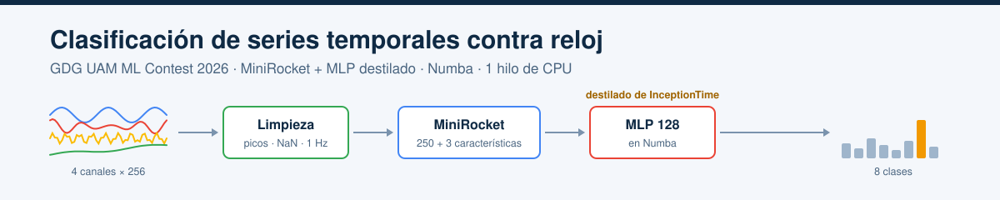
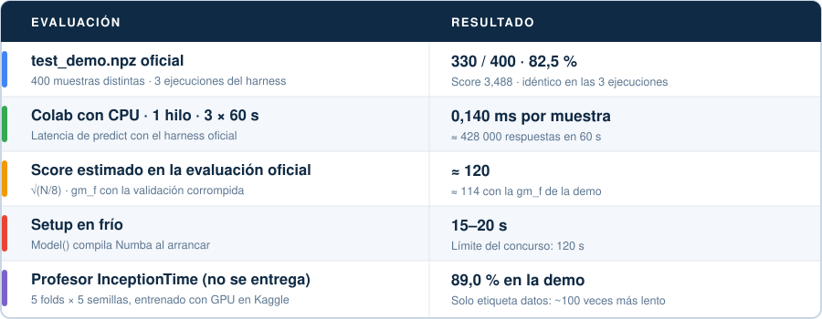
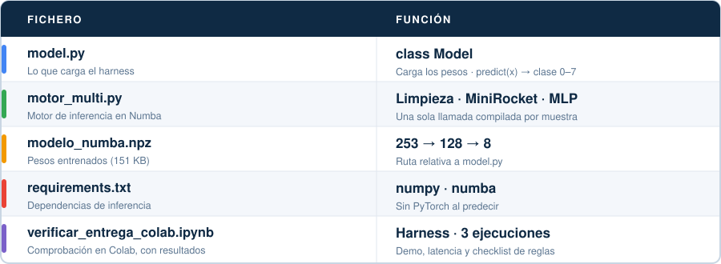

<p align="center"></p>

<p align="center">
  
  
  
  
  <a href="https://colab.research.google.com/github/diegoarangureen/gdg-ml-contest-entrega/blob/main/verificar_entrega_colab.ipynb"></a>
  <a href="LICENSE"></a>
</p>

# Entrega · GDG UAM ML Contest 2026

Clasificador de series temporales de 4 canales × 256 pasos en 8 clases para el [GDG UAM ML Contest 2026](https://gdguam.es/l/ml-contest). El harness oficial llama a `predict` con una muestra cada vez y el score combina el acierto por clase con cuántas muestras se contestan en 60 s, así que el modelo tiene que aguantar el cambio de distribución entre train y test y responder en mucho menos de un milisegundo.

**Equipo:** Xabat Arin Mendizabal ([@xabat111](https://github.com/xabat111)) y Diego Aranguren Gracia ([@diegoarangureen](https://github.com/diegoarangureen)).

## Cómo funciona

`model.py` carga `modelo_numba.npz` y hace todo en **una sola llamada compilada con Numba por muestra**:

1. **Limpieza robusta:** picos y tramos congelados a NaN, interpolación, normalización mediana/IQR por canal y remuestreo a 1 Hz con `sample_rate`. No usa `level`, `group` ni la escala absoluta, que en train delataban la clase pero no en test.
2. **253 características:** 250 de [MiniRocket](https://arxiv.org/abs/2012.08791) y 3 de asimetría temporal.
3. **MLP 253 → 128 → 8**, destilado de un ensemble de tres MLP de 256 que a su vez aprendieron de un **InceptionTime** (5 folds × 5 semillas, entrenado con GPU en Kaggle) sobre datos corrompidos como los de test.

Al predecir no hace falta PyTorch ni internet, y el modelo nunca se abstiene.

## Resultados



El score estimado es `√(N/8)·gm_f`, con `N = 60 s / latencia media` y la gm_f medida en una validación corrompida de 57 000 filas (0,520).

| Modelo | Acierto demo | Latencia (Colab) | Score estimado |
|---|---|---|---|
| Baseline oficial | 43,3 % | ~35 ms | ~2 |
| Primer alumno rápido (MiniRocket 250 + MLP 64) | 81,8 % | 0,166 ms | ~101 |
| **Esta entrega** | **82,5 %** | **0,140 ms** | **≈ 120** |
| Profesor InceptionTime (no se entrega) | 89,0 % | ~15–30 ms | ~11–16 |

## Ficheros



## Comprobarlo

Desde una carpeta vacía (en Windows, usa `curl.exe` y `.venv\Scripts\python.exe`):

```bash
git clone https://github.com/diegoarangureen/gdg-ml-contest-entrega.git submission-check
git clone https://github.com/GDG-UAM/ml-contest-materials.git
python -m venv .venv && .venv/bin/python -m pip install -r submission-check/requirements.txt
curl -fL --create-dirs -o ml-contest-materials/data/test_demo.npz \
  https://github.com/GDG-UAM/ml-contest-materials/releases/latest/download/test_demo.npz
cd ml-contest-materials
../.venv/bin/python harness.py evaluate --model ../submission-check/model.py --source file:data/test_demo.npz --runs 1
```

Debe dar 330 aciertos de 400 y score 3,488. También se puede abrir el [notebook de verificación en Colab](https://colab.research.google.com/github/diegoarangureen/gdg-ml-contest-entrega/blob/main/verificar_entrega_colab.ipynb): mide la demo y la latencia con 3 ejecuciones y repasa las reglas del concurso.

## Posibles mejoras y líneas futuras

- **Corregir los priors sin etiquetas:** ajustar un desplazamiento de los logits por clase, sobre todo en la 6 y la 7, con datos tipo test sin etiquetar. Con la validación de train no aportaba nada, porque el desequilibrio solo aparece en datos tipo test.
- **Superar el techo de MiniRocket:** el alumno se queda en gm_f ≈ 0,52 y el profesor llega a 0,72. Una CNN 1D algo mayor (~50 k parámetros) servida con ONNX Runtime, o un alumno híbrido MiniRocket + CNN pequeña, podría captar más del profesor con una latencia parecida.
- **Más características a mano:** en el análisis, la asimetría temporal separaba las clases 4 y 5, la cuadratura de fase entre los canales 0 y 1 marcaba la clase 1 y la modulación de amplitud, la 3. Añadirlas al alumno cuesta poco en Numba.
- **Destilación más fuerte:** usar como profesor el ensemble InceptionTime + ConvTran (90,0 % en la demo) y entrenar los alumnos en GPU con muchas más pasadas corrompidas.
- **Inferencia más ligera:** simplificar la limpieza y probar pesos en int8/fp16 para contestar más muestras en 60 s.
- **Mejor simulador del test:** reproducir mejor el cambio de la clase 6, para que la validación se parezca todavía más a la demo.

## Licencia

[MIT](LICENSE) © 2026 Xabat Arin Mendizabal y Diego Aranguren Gracia.
